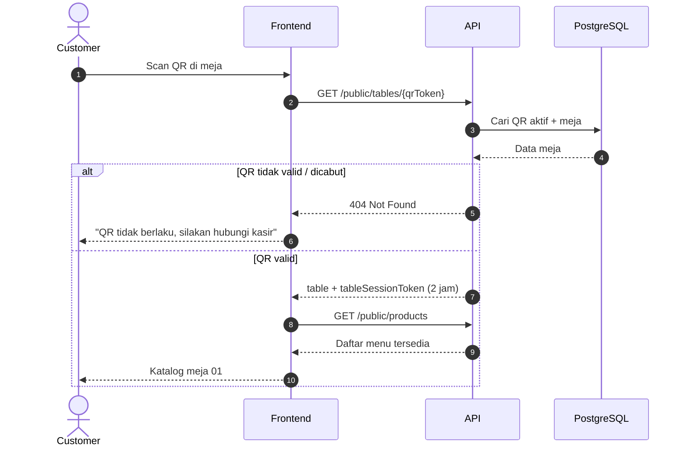
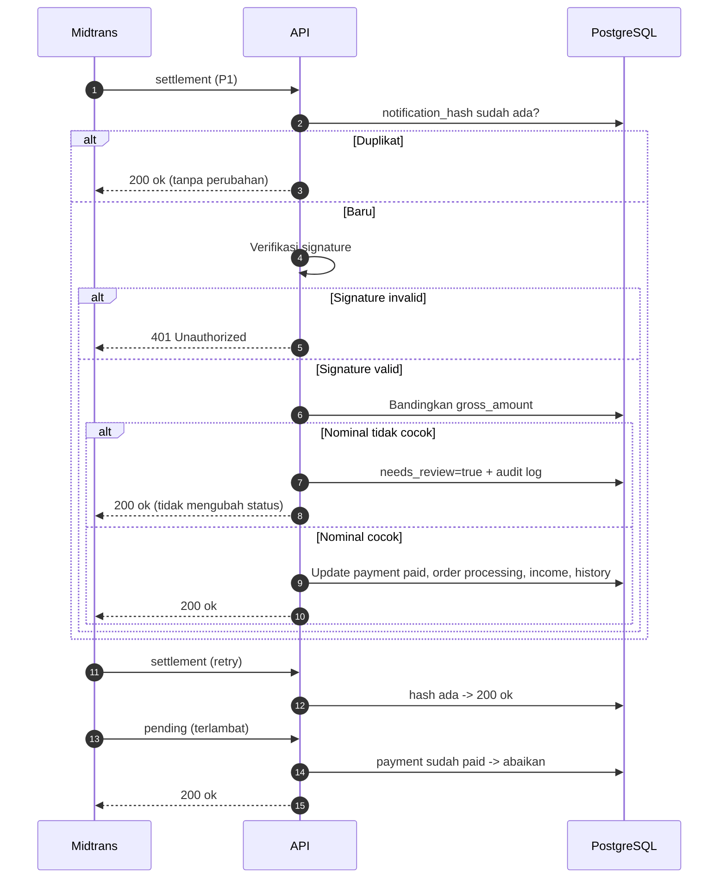
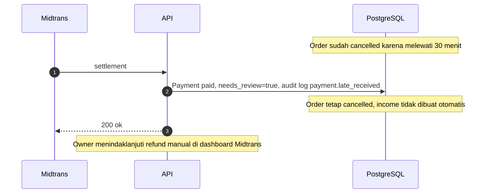
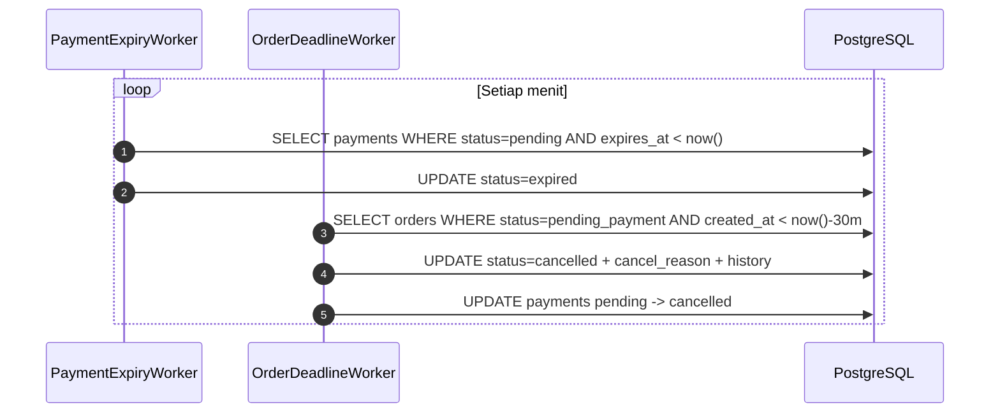
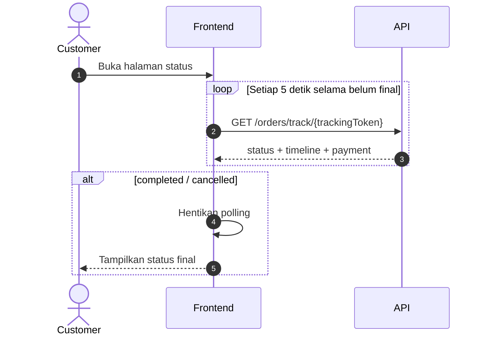
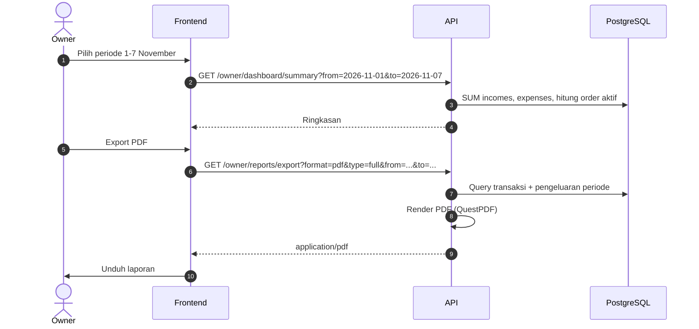
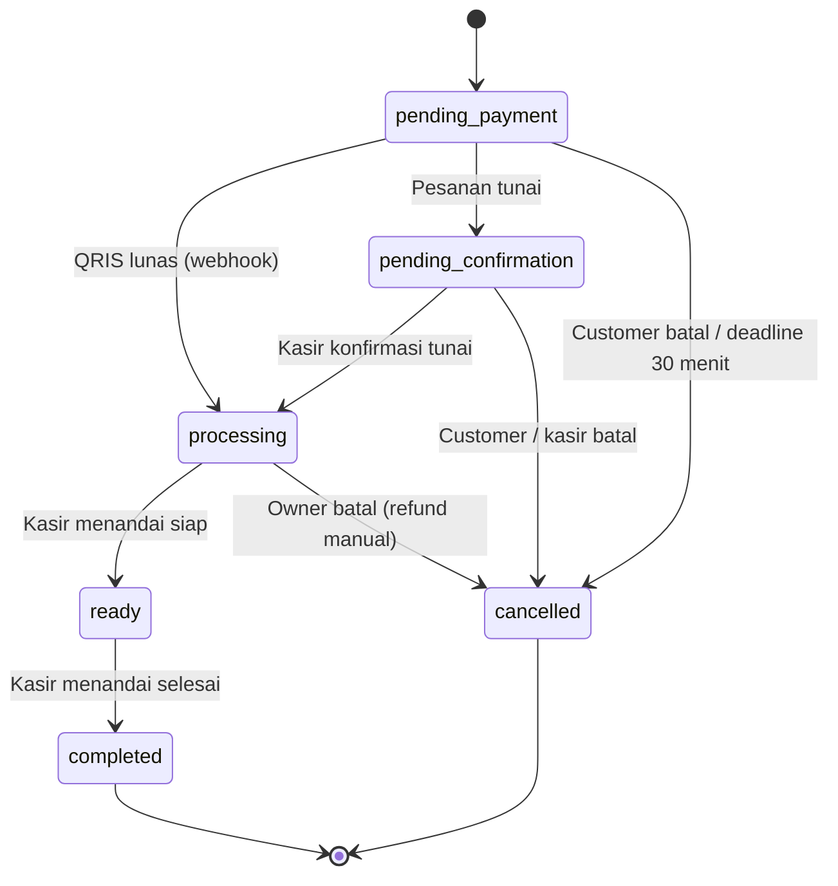
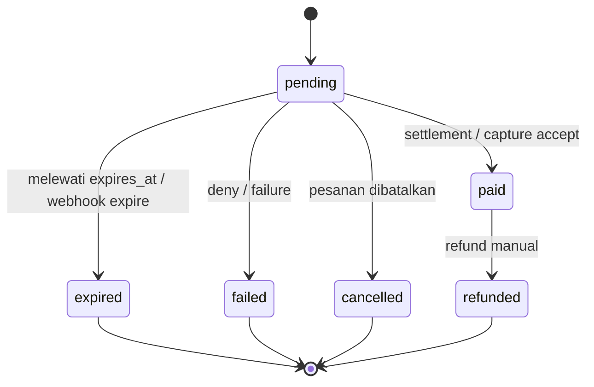
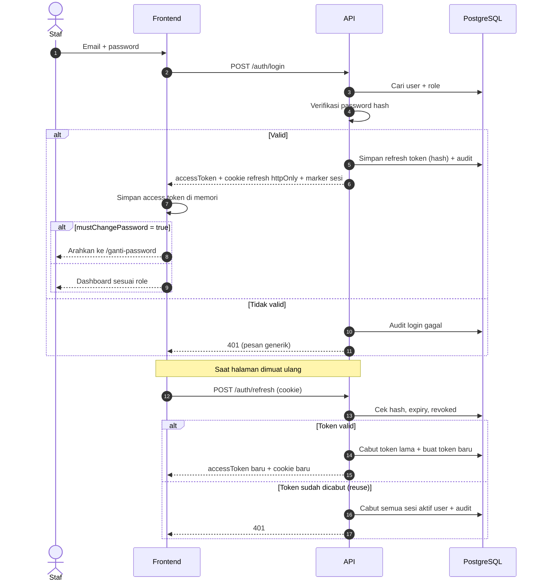

# ALUR SISTEM — HANORA CAFE

**Versi:** 1.0 (Tahap 2)
**Tujuan:** Mendefinisikan urutan interaksi, state machine, dan penanganan kasus tepi sebelum implementasi.

---

## 1. Scan QR dan Sesi Meja



Aturan:
- Sesi meja adalah JWT audience `table`, bukan access token staf.
- Jika QR diregenerasi, sesi lama tidak dapat membuat pesanan baru karena backend memeriksa ulang status QR.
- Customer tidak memasukkan nomor meja secara manual.

---

## 2. Pesanan QRIS (Midtrans)

```mermaid
sequenceDiagram
    autonumber
    actor C as Customer
    participant FE as Frontend
    participant API as API
    participant DB as PostgreSQL
    participant MT as Midtrans

    C->>FE: Isi nama, pilih QRIS, checkout
    FE->>API: POST /orders (Bearer sesi meja, Idempotency-Key)
    API->>DB: Validasi produk & hitung ulang harga
    API->>DB: BEGIN; INSERT order + items; COMMIT
    API->>MT: Buat transaksi Snap (QRIS)
    alt Snap gagal
        API->>DB: Tandai payment gagal dibuat
        API-->>FE: 502 "Pembayaran belum dapat dibuat"
        FE-->>C: Tawarkan coba lagi
    else Snap berhasil
        API->>DB: Simpan snap_token, redirect_url, expires_at
        API-->>FE: 201 order + snapToken
        FE->>MT: Buka halaman Snap / tampilkan QRIS
        C->>MT: Bayar dengan aplikasi bank/e-wallet
        MT->>API: POST /webhooks/midtrans
        API->>API: Verifikasi signature + nominal + idempotency
        API->>DB: BEGIN; lock payment; update paid; order processing; income; history; COMMIT
        API-->>MT: 200 { status: ok }
        loop Polling setiap 5 detik
            FE->>API: GET /orders/track/{trackingToken}
            API-->>FE: status processing, payment paid
        end
        FE-->>C: "Pembayaran berhasil, pesanan diproses"
    end
```

Catatan:
- Panggilan ke Midtrans **tidak** dilakukan di dalam transaksi database yang panjang.
- `gross_amount` yang dikirim ke Midtrans sama dengan `orders.total` (termasuk PB1).
- Frontend tidak pernah menerima Server Key.
- Status final selalu diambil dari backend, bukan dari callback Snap di browser.

---

## 3. Pesanan Tunai

```mermaid
sequenceDiagram
    autonumber
    actor C as Customer
    participant FE as Frontend
    participant API as API
    participant DB as PostgreSQL
    actor K as Kasir

    C->>FE: Pilih tunai, checkout
    FE->>API: POST /orders (paymentMethod=cash)
    API->>DB: BEGIN; INSERT order pending_confirmation + payment manual pending; COMMIT
    API-->>FE: 201 order + trackingToken
    FE-->>C: "Tunjukkan nomor pesanan ke kasir"
    C->>K: Datang ke kasir dan bayar
    K->>API: POST /cashier/orders/{id}/confirm-cash
    API->>DB: BEGIN; lock; payment paid; order processing; income; history; COMMIT
    API-->>K: Detail pesanan
    FE->>API: GET /orders/track/{trackingToken}
    API-->>FE: processing + paid
```

Aturan:
- Tunai tidak melalui Midtrans.
- Pesanan tunai langsung `pending_confirmation`, bukan `pending_payment`.
- Jika customer pergi tanpa membayar, kasir membatalkan pesanan dengan alasan.

---

## 4. Perubahan Status oleh Kasir

```mermaid
sequenceDiagram
    autonumber
    actor K as Kasir
    participant API as API
    participant DB as PostgreSQL

    K->>API: PATCH /cashier/orders/{id}/status { toStatus: ready }
    API->>DB: BEGIN; SELECT order FOR UPDATE
    API->>API: Validasi transisi processing -> ready
    alt Transisi tidak sah
        API-->>K: 409 invalid-status-transition
    else Valid
        API->>DB: UPDATE order + INSERT transaction_history
        API->>DB: COMMIT
        API-->>K: Detail terbaru
    end
    K->>API: PATCH ... { toStatus: completed }
    API->>DB: UPDATE ready -> completed + completed_at + history
```

Transisi kasir:
- `pending_confirmation → processing` (setelah tunai dikonfirmasi)
- `processing → ready`
- `ready → completed`
- `pending_confirmation → cancelled`

Kasir tidak dapat membatalkan pesanan yang sudah `processing`/`ready`; pembatalan setelah pembayaran ditangani owner secara manual (refund di luar sistem).

---

## 5. Webhook: Duplikat, Terlambat, dan Nominal Tidak Cocok



Kasus pembayaran telat setelah pesanan dibatalkan:



Prinsip:
- `paid` bersifat final; notifikasi `pending` yang datang belakangan tidak menurunkannya.
- Uang yang masuk tidak boleh hilang dari catatan: payment tetap `paid`, tetapi `needs_review` menandai tindakan manual.
- Semua penyimpangan dicatat di `audit_logs`.

---

## 6. Kedaluwarsa Pembayaran dan Batas Pesanan



- QRIS kedaluwarsa 15 menit; customer masih dapat membuat payment attempt baru selama pesanan belum melewati 30 menit.
- Setelah 30 menit, pesanan dibatalkan otomatis.
- Worker menggunakan advisory lock bila API dijalankan lebih dari satu instance.

---

## 7. Tracking Pesanan Customer



- Polling berhenti saat tab tidak aktif (`document.visibilityState`).
- Token tracking disimpan di `sessionStorage`; jika hilang, customer scan ulang QR.
- Endpoint tracking tidak menampilkan data internal (ID database, catatan kasir, token pembayaran).

---

## 8. Laporan Owner



- Export dibatasi maksimal 1 tahun per permintaan untuk menjaga memori.
- Nama file: `Laporan-Hanora-2026-11-01_2026-11-07.pdf` / `.xlsx`.
- Angka laporan berasal dari database, bukan state frontend.

---

## 9. State Machine

### 9.1 Status pesanan



### 9.2 Status pembayaran



---

## 10. Kasus Tepi dan Perilaku yang Diharapkan

| Kasus | Perilaku |
|---|---|
| QR tidak valid/dicabut | `404`, customer diarahkan ke kasir |
| QR diregenerasi saat sesi aktif | Pesanan baru ditolak; customer scan ulang |
| Produk menjadi tidak tersedia setelah masuk keranjang | Checkout ditolak `409` dengan daftar produk |
| Harga berubah setelah masuk keranjang | Server memakai harga terbaru; total dihitung ulang |
| Double tap checkout | Idempotency-Key mengembalikan pesanan yang sama |
| Snap gagal dibuat | Pesanan tetap ada; customer dapat mencoba lagi |
| QRIS kedaluwarsa | Payment `expired`; customer dapat membuat attempt baru selama < 30 menit |
| Melewati 30 menit | Pesanan `cancelled`; payment pending menjadi `cancelled` |
| Webhook duplikat | `200` tanpa perubahan |
| Webhook dengan signature salah | `401`, dicatat, tidak ada perubahan |
| Nominal webhook tidak cocok | `needs_review=true`, status tidak berubah, audit log |
| Webhook `pending` setelah `paid` | Diabaikan; `paid` final |
| Pembayaran masuk setelah pesanan dibatalkan | Payment `paid` + `needs_review`, order tetap `cancelled`, refund manual |
| Customer membatalkan setelah `processing` | Ditolak `409`; hubungi kasir |
| Kasir membatalkan pesanan yang sudah dibayar | Tidak diizinkan lewat endpoint kasir; owner menangani refund manual |
| Refresh token dipakai dua kali bersamaan | Rotasi single-flight; token lama dicabut, sesi lain diminta login ulang |
| Server restart | Data aman di PostgreSQL; worker melanjutkan pemeriksaan |
| Midtrans tidak dapat dihubungi | Pesanan tetap `pending_payment`; error ditampilkan; coba lagi |
| Tab customer ditutup | Pesanan tetap diproses; status dapat dilihat dengan scan ulang QR |

---

## 11. Definisi "Selesai"

Pesanan dianggap selesai ketika:
1. Pembayaran berstatus `paid`; dan
2. Kasir menandai `completed`.

Pesanan `cancelled` tidak dihitung sebagai pendapatan. Pembayaran telat yang memerlukan refund tidak dihitung sebagai pendapatan sampai keputusan owner dicatat.

---

## 12. Alur Autentikasi Staf



Aturan:
- Access token tidak disimpan di `localStorage`; hanya di memori.
- Refresh token httpOnly, `SameSite=Lax`, path `/api/v1/auth`.
- Cookie penanda `hanora_session` hanya untuk bootstrap, bukan otorisasi.
- Endpoint staf yang wajib ganti password akan menolak akses `403 password-change-required` sampai password diubah.
- Ganti password mencabut seluruh refresh token; pengguna harus login ulang.
- Owner tidak dapat menonaktifkan dirinya sendiri atau menghapus owner aktif terakhir.
