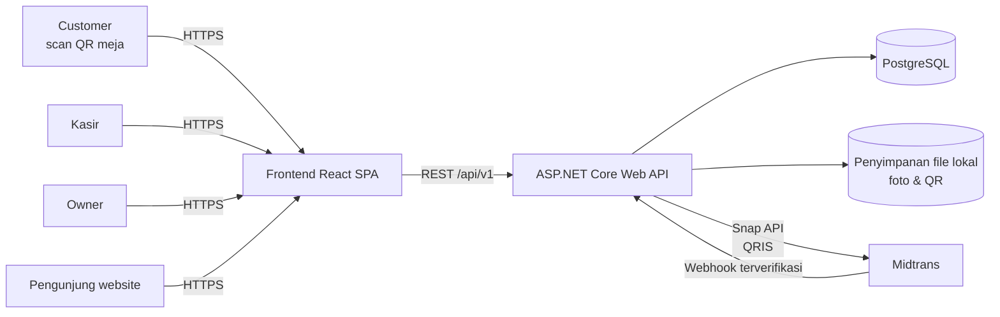
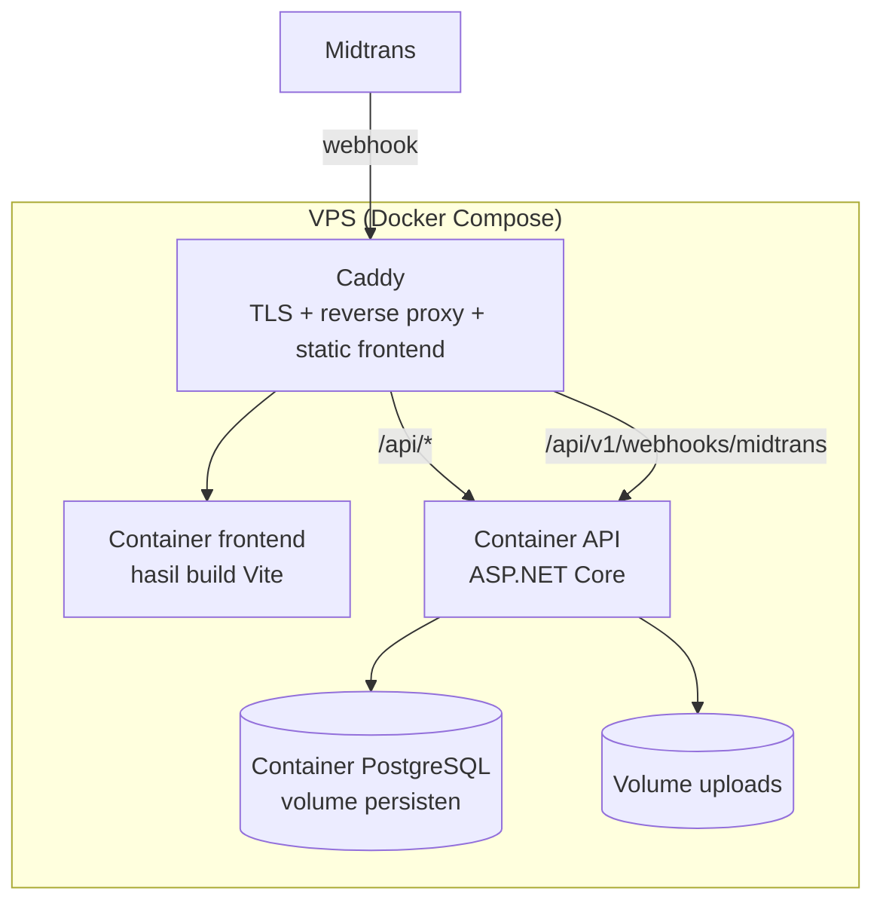

# ARSITEKTUR SISTEM — HANORA CAFE

**Versi:** 1.0 (Tahap 2)
**Tanggal:** 7 November 2026
**Status:** Final untuk direview sebelum implementasi

---

## 1. Tujuan

Membangun sistem coffee shop yang mencakup website publik, pemesanan mandiri melalui QR meja, dashboard kasir, dashboard owner, manajemen produk, pembayaran QRIS melalui Midtrans, serta laporan keuangan. Sistem menggantikan prototype statis dengan aplikasi yang memiliki backend, database, autentikasi, dan pembayaran nyata.

---

## 2. Prinsip Arsitektur

1. **Server-authoritative** — harga, pajak, total, dan status pembayaran dihitung dan diverifikasi di backend. Frontend tidak pernah mengirim harga final yang dipercaya.
2. **Snapshot transaksi** — `order_items` menyimpan nama dan harga produk pada saat transaksi, sehingga perubahan harga di masa depan tidak mengubah riwayat.
3. **Pemisahan status** — status pesanan dan status pembayaran adalah dua state machine terpisah.
4. **Guest via QR** — customer tidak memiliki akun. Identitas meja berasal dari token QR yang valid dan sesi meja berumur pendek.
5. **Least privilege** — Owner, Kasir, dan sesi meja memiliki izin berbeda; endpoint dijaga di backend, bukan hanya di UI.
6. **Uang sebagai `numeric`** — tidak ada `float`/`double` untuk nominal.
7. **Idempoten** — pembuatan pesanan dan pemrosesan webhook aman terhadap retry/double submit.
8. **Aset lokal** — logo, foto produk, dan QR disimpan di server; tidak bergantung pada layanan gambar eksternal.
9. **Bahasa Indonesia** — seluruh teks UI, pesan error, dan laporan menggunakan bahasa Indonesia.
10. **Tanpa data palsu di produksi** — seed hanya berisi role dan akun owner. Data demo tidak pernah diaktifkan di production.

---

## 3. Stack Final

### Frontend

| Komponen | Pilihan | Keterangan |
|---|---|---|
| Framework | React 19 | SPA |
| Build tool | Vite 8 | Dev server & build |
| Bahasa | TypeScript 7 | Strict mode |
| Styling | Tailwind CSS 3.4 | Token warna/font dari prototype dipertahankan |
| Routing | React Router 7 | Route publik, kasir, owner |
| HTTP | Axios | Interceptor token & error |
| State | Zustand 5 | Auth, keranjang, sesi meja |
| Grafik | Recharts 3 | Grafik owner |
| Ikon | Lucide React | Konsisten dengan prototype |
| Testing | Vitest + React Testing Library + Playwright | Unit/komponen dan E2E |

### Backend

| Komponen | Pilihan |
|---|---|
| Runtime | .NET 10 LTS |
| Web framework | ASP.NET Core Web API (controllers) |
| ORM | EF Core 10 + Npgsql |
| Autentikasi | JWT Bearer + refresh token |
| Password hashing | ASP.NET Core `PasswordHasher<T>` (PBKDF2-HMAC-SHA512, iterasi tinggi) |
| Validasi | FluentValidation + DataAnnotations |
| Logging | Serilog (console + file terotasi) |
| Rate limiting | ASP.NET Core Rate Limiter |
| QR | QRCoder (PNG/SVG) |
| PDF | QuestPDF (Community License) |
| Excel | ClosedXML |
| API docs | Microsoft.AspNetCore.OpenApi + Scalar (hanya Development) |
| Testing | xUnit + FluentAssertions + Testcontainers (PostgreSQL) |

### Database & Infrastruktur

| Komponen | Pilihan |
|---|---|
| Database | PostgreSQL 17 |
| Migrasi | EF Core Migration |
| Reverse proxy / TLS | Caddy 2 (HTTPS otomatis) |
| Container | Docker + Docker Compose |
| File storage | Volume lokal `/var/hanora/uploads` |
| Backup | `pg_dump` harian + retensi 14 hari |

---

## 4. Diagram Konteks



---

## 5. Diagram Container



---

## 6. Frontend

### 6.1 Shell aplikasi

| Shell | Route | Layout |
|---|---|---|
| Publik | `/`, `/menu`, `/galeri`, `/lokasi`, `/masuk` | Header publik + footer; tanpa sidebar admin |
| Staf (auth) | `/ganti-password` | Halaman khusus ganti password wajib |
| Customer | `/t/:qrToken`, `/pesan`, `/checkout`, `/pesanan/:trackingToken` | Header ringkas + status meja + keranjang |
| Kasir | `/kasir`, `/kasir/pesanan/:id`, `/kasir/riwayat` | Sidebar operasional |
| Owner | `/owner`, `/owner/produk`, `/owner/kategori`, `/owner/meja`, `/owner/laporan`, `/owner/pengeluaran`, `/owner/pengguna`, `/owner/pengaturan` | Sidebar owner |

Route guard:
- `/kasir/*` membutuhkan role `Cashier` atau `Owner`.
- `/owner/*` membutuhkan role `Owner`.
- `/pesan` dan `/checkout` membutuhkan sesi meja yang valid.
- Jika sesi meja kedaluwarsa, customer diarahkan untuk scan ulang QR.
- Jika `mustChangePassword = true`, pengguna staf diarahkan ke `/ganti-password` dan endpoint staf lain ditolak backend.

### 6.2 State management

| Store | Isi | Persistensi |
|---|---|---|
| `authStore` | access token, profil, role | access token di memori; refresh via cookie httpOnly |
| `tableStore` | tableId, nomor meja, sesi meja | `sessionStorage` |
| `cartStore` | item, qty, catatan | `sessionStorage`, di-scope per meja |
| `uiStore` | toast, modal | tidak dipersistensi |

Keranjang **tidak** mengirim harga ke server. Yang dikirim hanya `productId`, `quantity`, dan `notes`.

### 6.3 Struktur folder frontend

```
frontend/src/
├─ app/                 # router, providers, query client, guards
├─ components/
│  ├─ ui/               # Button, Pill, Stat, Modal, Table, EmptyState, Toast
│  ├─ layout/           # PublicLayout, CashierLayout, OwnerLayout
│  └─ charts/           # SalesAreaChart, TopProductBar
├─ features/
│  ├─ auth/
│  ├─ public/
│  ├─ ordering/
│  ├─ cashier/
│  ├─ owner/
│  ├─ products/
│  ├─ tables/
│  └─ reports/
├─ lib/                 # axios, formatRupiah, formatTanggal, validasi
├─ stores/
├─ types/
└─ styles/
```

### 6.4 Design system

Token diambil dari prototype dan dipindahkan ke `tailwind.config.ts`:

- Warna: `coffee-950` … `coffee-50`, `caramel`, aksen `#e5bd91`.
- Font: DM Sans (body), Playfair Display (heading).
- Radius: 12/16/24/28 px.
- Shadow: `0 16px 50px rgba(55,36,25,.08)`.
- Komponen dasar: Button (primary/outline/ghost), Pill (brown/green/amber/red/gray), Stat card, SectionTitle, Modal.

Perubahan desain hanya boleh dilakukan bila diperlukan oleh fungsi baru (misalnya state loading/error, form upload, tabel laporan) dan tetap mengikuti bahasa visual tersebut.

### 6.5 Format & perilaku UI

- Rupiah: `Rp 32.000` (tanpa desimal).
- Tanggal: `7 November 2026`, waktu `14:30 WIB`.
- Loading: skeleton pada tabel/kartu; spinner pada tombol submit.
- Empty state: pesan jelas + aksi (misalnya "Belum ada pesanan").
- Error state: pesan yang bisa ditindaklanjuti, bukan kode mentah.
- Success: toast + perubahan status langsung.
- Konfirmasi modal untuk aksi destruktif (hapus produk, batalkan pesanan).

---

## 7. Backend

### 7.1 Layer dan tanggung jawab

| Project | Tanggung jawab |
|---|---|
| `Hanora.Api` | Controller, middleware, DI, konfigurasi, OpenAPI, rate limit |
| `Hanora.Application` | Use case/service, DTO, validasi, transaksi bisnis |
| `Hanora.Domain` | Entity, enum, aturan domain, kontrak repository |
| `Hanora.Infrastructure` | EF Core, Npgsql, repository, Midtrans client, file storage, QR, export, JWT |

Aturan dependensi: `Api → Application → Domain`; `Infrastructure → Application/Domain`. Domain tidak bergantung pada framework.

### 7.2 Modul backend

| Modul | Isi |
|---|---|
| Auth | Login, refresh, logout, profil, rotasi refresh token |
| Public | Profil bisnis, kategori, produk, validasi QR meja |
| Ordering | Buat pesanan, tracking, pembatalan customer, retry QRIS |
| Payments | Pembuatan Snap QRIS, status, webhook, idempotency, expiry worker |
| Cashier | Antrean, detail, transisi status, konfirmasi tunai, riwayat |
| Catalog | CRUD kategori/produk, upload gambar, ketersediaan |
| Tables | CRUD meja, generate/regenerate QR |
| Finance | Pengeluaran, pemasukan manual, ringkasan, laporan, export |
| Users | CRUD user internal, role, status aktif |
| Settings | Profil bisnis, pajak, batas waktu pembayaran |
| Audit | Log aksi sensitif |

### 7.3 Pipeline middleware (urutan)

1. Exception handler → ProblemDetails.
2. HSTS (production) + security headers.
3. HTTPS redirection (production).
4. CORS dengan allowlist.
5. Rate limiter.
6. Authentication.
7. Authorization.
8. Request logging (Serilog, tanpa body sensitif).
9. Controllers.

### 7.4 Background worker

| Worker | Tugas |
|---|---|
| `PaymentExpiryWorker` | Menandai payment `PENDING` yang melewati `expires_at` menjadi `EXPIRED`. |
| `OrderDeadlineWorker` | Membatalkan pesanan `PENDING_PAYMENT` yang melewati batas 30 menit, mencatat riwayat. |
| `RefreshTokenCleanupWorker` | Menghapus refresh token kedaluwarsa. |

Worker berjalan di instance API. Untuk VPS satu instance, ini aman. Jika nanti multi-instance, gunakan advisory lock PostgreSQL agar tidak dobel proses.

### 7.5 Format respons error

Menggunakan RFC 7807 ProblemDetails:

```json
{
  "type": "https://hanora.example.com/errors/validation",
  "title": "Validasi gagal",
  "status": 400,
  "detail": "Periksa kembali data yang dikirim.",
  "instance": "/api/v1/orders",
  "traceId": "00-...",
  "errors": {
    "customerName": ["Nama wajib diisi."]
  }
}
```

---

## 8. Data & Penyimpanan

- **PostgreSQL** menyimpan seluruh data bisnis, termasuk snapshot item pesanan.
- **Volume lokal** menyimpan foto produk. Nama file diacak (UUID), ekstensi divalidasi, dan file tidak dieksekusi.
- **QR** dihasilkan on-demand dari token di database; tidak menyimpan gambar QR agar token bisa diregenerasi.
- **Export** PDF/Excel dihasilkan di server dari data database, bukan dari state frontend.
- **Tidak ada data transaksi dummy** di database produksi.

Detail skema ada di [DATABASE.md](DATABASE.md).

---

## 9. Integrasi Midtrans

- **Mode:** `simulation`, `sandbox`, `production` melalui environment variable.
- **Metode:** hanya **QRIS** melalui Snap API. Transfer bank tidak disediakan.
- **Tunai:** bukan transaksi Midtrans; dikonfirmasi manual oleh kasir.
- **Server Key** hanya ada di backend dan tidak pernah dikirim ke frontend.
- **Webhook** diverifikasi signature SHA-512, nominal, dan idempotency sebelum mengubah status.
- **Mode simulasi** memiliki penanda jelas "SIMULASI — bukan pembayaran sungguhan" dan endpoint simulasi hanya aktif di Development.
- Dokumentasi konfigurasi rinci akan dibuat di `docs/MIDTRANS_SETUP.md` pada Tahap 8.

Alur lengkap ada di [ALUR_SISTEM.md](ALUR_SISTEM.md).

---

## 10. Deployment VPS

### 10.1 Topologi

```
Internet → Caddy (80/443, TLS otomatis)
              ├─ /*            → container frontend (static build)
              ├─ /api/*        → container api (ASP.NET Core, port internal 8080)
              └─ /media/*      → volume uploads
Container api → container postgres (port internal 5432, tidak diekspos)
```

### 10.2 Konfigurasi minimum VPS

| Komponen | Rekomendasi |
|---|---|
| OS | Ubuntu 24.04 LTS |
| CPU/RAM | 2 vCPU / 4 GB RAM (minimum 2 GB) |
| Disk | 40 GB SSD |
| Firewall | Hanya 22, 80, 443 terbuka |
| Database | Tidak diekspos ke internet |
| Backup | Harian ke direktori terpisah, retensi 14 hari |

### 10.3 Operasional

- Migrasi dijalankan eksplisit saat deploy, bukan otomatis di setiap restart.
- Health check: `/api/v1/health` dan `/api/v1/health/ready`.
- Log API ke stdout (Docker) + file terotasi.
- Secret disimpan di `.env` dengan permission ketat, tidak masuk Git.
- Restore backup diuji minimal sekali sebelum go-live.

---

## 11. Non-Goals (Tidak Dikerjakan pada Versi Ini)

- Akun/login customer, loyalty, poin, atau membership.
- Transfer bank manual.
- Multi-outlet atau multi-tenant.
- Manajemen stok bahan baku dan resep.
- Reservasi meja.
- Refund otomatis via Midtrans (refund ditangani manual di dashboard Midtrans; sistem mencatat catatan).
- Aplikasi mobile native.
- Realtime WebSocket (menggunakan polling 5 detik pada versi pertama).

---

## 12. Referensi

- [DATABASE.md](DATABASE.md)
- [API.md](API.md)
- [openapi.yaml](openapi.yaml)
- [ALUR_SISTEM.md](ALUR_SISTEM.md)
- [KEAMANAN.md](KEAMANAN.md)
- [KEPUTUSAN_TEKNIS.md](KEPUTUSAN_TEKNIS.md)
