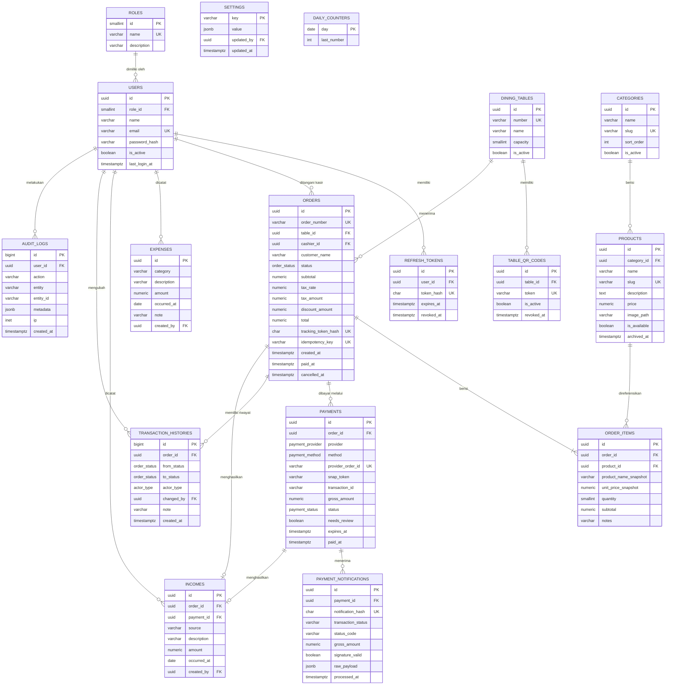

# DATABASE & ERD FINAL — HANORA CAFE

**Versi:** 1.0 (Tahap 2)
**Database:** PostgreSQL 17
**ORM:** EF Core 10 + Npgsql
**Status:** Final untuk direview sebelum migration dibuat

---

## 1. Konvensi

| Aspek | Aturan |
|---|---|
| Penamaan | `snake_case`, tabel plural |
| Primary key | `uuid` (`gen_random_uuid()`) kecuali tabel log memakai `bigserial` |
| Waktu | `timestamptz`, disimpan UTC, ditampilkan `Asia/Jakarta` |
| Uang | `numeric(12,2)`; tidak boleh `float`/`double` |
| Persentase | `numeric(5,2)` (contoh `10.00`) |
| Enum | PostgreSQL native enum |
| Soft delete | Hanya `products.archived_at`; pesanan tidak dihapus |
| Foreign key | `RESTRICT` secara default; `CASCADE` hanya untuk anak yang tidak punya nilai historis mandiri |
| Audit | Perubahan status pesanan dan aksi sensitif dicatat |
| Nama tabel meja | `dining_tables` (bukan `tables`) agar tidak rancu dengan istilah SQL |

---

## 2. Enum

```sql
CREATE TYPE order_status AS ENUM (
  'pending_payment',        -- Menunggu Pembayaran
  'pending_confirmation',   -- Menunggu Konfirmasi (tunai)
  'processing',             -- Diproses
  'ready',                  -- Siap Disajikan
  'completed',              -- Selesai
  'cancelled'               -- Dibatalkan
);

CREATE TYPE payment_status AS ENUM (
  'pending', 'paid', 'failed', 'expired', 'refunded', 'cancelled'
);

CREATE TYPE payment_method AS ENUM ('qris', 'cash');
CREATE TYPE payment_provider AS ENUM ('midtrans', 'manual');
CREATE TYPE actor_type AS ENUM ('system', 'cashier', 'owner', 'customer');
```

Label UI (Bahasa Indonesia):

| Enum | Label |
|---|---|
| `pending_payment` | Menunggu Pembayaran |
| `pending_confirmation` | Menunggu Konfirmasi |
| `processing` | Diproses |
| `ready` | Siap Disajikan |
| `completed` | Selesai |
| `cancelled` | Dibatalkan |
| `pending` | Menunggu |
| `paid` | Lunas |
| `failed` | Gagal |
| `expired` | Kedaluwarsa |
| `refunded` | Dikembalikan |
| `cancelled` (payment) | Dibatalkan |

---

## 3. ERD



---

## 4. Kamus Tabel

### 4.1 `roles`

| Kolom | Tipe | Constraint | Keterangan |
|---|---|---|---|
| `id` | `smallint` | PK, identity | |
| `name` | `varchar(32)` | NOT NULL, UNIQUE | `Owner`, `Cashier`, `Customer` |
| `description` | `varchar(255)` | NULL | |
| `created_at` | `timestamptz` | NOT NULL, default `now()` | |

### 4.2 `users`

| Kolom | Tipe | Constraint | Keterangan |
|---|---|---|---|
| `id` | `uuid` | PK, default `gen_random_uuid()` | |
| `role_id` | `smallint` | FK `roles(id)`, NOT NULL | |
| `name` | `varchar(100)` | NOT NULL | |
| `email` | `varchar(254)` | NOT NULL, UNIQUE (lowercase) | Login |
| `password_hash` | `varchar(255)` | NOT NULL | `PasswordHasher<T>` |
| `must_change_password` | `boolean` | NOT NULL, default `false` | Wajib ganti password (akun awal/user baru) |
| `is_active` | `boolean` | NOT NULL, default `true` | |
| `last_login_at` | `timestamptz` | NULL | |
| `created_at` | `timestamptz` | NOT NULL, default `now()` | |
| `updated_at` | `timestamptz` | NOT NULL, default `now()` | |

Catatan: tidak ada user dengan role `Customer`. Role ini dipakai sebagai principal pada sesi meja (JWT audience `table`), bukan akun login.

### 4.3 `refresh_tokens`

| Kolom | Tipe | Constraint | Keterangan |
|---|---|---|---|
| `id` | `uuid` | PK | |
| `user_id` | `uuid` | FK `users(id)` ON DELETE CASCADE, NOT NULL | |
| `token_hash` | `char(64)` | NOT NULL, UNIQUE | SHA-256 dari token acak |
| `expires_at` | `timestamptz` | NOT NULL | 7 hari |
| `revoked_at` | `timestamptz` | NULL | |
| `replaced_by_token_id` | `uuid` | NULL, FK self | Rotasi token |
| `created_ip` | `inet` | NULL | |
| `created_at` | `timestamptz` | NOT NULL, default `now()` | |

### 4.4 `dining_tables`

| Kolom | Tipe | Constraint | Keterangan |
|---|---|---|---|
| `id` | `uuid` | PK | |
| `number` | `varchar(10)` | NOT NULL, UNIQUE | Contoh `01`, `02`, `VIP-1` |
| `name` | `varchar(50)` | NOT NULL | Contoh `Meja 01` |
| `capacity` | `smallint` | NOT NULL, default `2`, CHECK `1..50` | |
| `is_active` | `boolean` | NOT NULL, default `true` | |
| `created_at` | `timestamptz` | NOT NULL, default `now()` | |
| `updated_at` | `timestamptz` | NOT NULL, default `now()` | |

### 4.5 `table_qr_codes`

| Kolom | Tipe | Constraint | Keterangan |
|---|---|---|---|
| `id` | `uuid` | PK | |
| `table_id` | `uuid` | FK `dining_tables(id)` ON DELETE RESTRICT, NOT NULL | |
| `token` | `varchar(64)` | NOT NULL, UNIQUE | Token acak URL-safe 32 byte |
| `is_active` | `boolean` | NOT NULL, default `true` | |
| `created_at` | `timestamptz` | NOT NULL, default `now()` | |
| `revoked_at` | `timestamptz` | NULL | |

Index unik parsial: hanya satu QR aktif per meja.

```sql
CREATE UNIQUE INDEX ux_table_qr_active
  ON table_qr_codes (table_id)
  WHERE is_active;
```

### 4.6 `categories`

| Kolom | Tipe | Constraint | Keterangan |
|---|---|---|---|
| `id` | `uuid` | PK | |
| `name` | `varchar(60)` | NOT NULL | |
| `slug` | `varchar(80)` | NOT NULL, UNIQUE | |
| `sort_order` | `int` | NOT NULL, default `0` | |
| `is_active` | `boolean` | NOT NULL, default `true` | |
| `created_at` | `timestamptz` | NOT NULL, default `now()` | |
| `updated_at` | `timestamptz` | NOT NULL, default `now()` | |

### 4.7 `products`

| Kolom | Tipe | Constraint | Keterangan |
|---|---|---|---|
| `id` | `uuid` | PK | |
| `category_id` | `uuid` | FK `categories(id)` ON DELETE RESTRICT, NOT NULL | |
| `name` | `varchar(120)` | NOT NULL | |
| `slug` | `varchar(140)` | NOT NULL, UNIQUE | |
| `description` | `text` | NULL | |
| `price` | `numeric(12,2)` | NOT NULL, CHECK `> 0` | |
| `image_path` | `varchar(255)` | NULL | Path relatif di volume upload |
| `is_available` | `boolean` | NOT NULL, default `true` | Tampil/tidak di menu |
| `archived_at` | `timestamptz` | NULL | Soft delete |
| `created_at` | `timestamptz` | NOT NULL, default `now()` | |
| `updated_at` | `timestamptz` | NOT NULL, default `now()` | |

Produk yang diarsipkan tidak boleh muncul di menu publik dan tidak boleh dipesan.

### 4.8 `orders`

| Kolom | Tipe | Constraint | Keterangan |
|---|---|---|---|
| `id` | `uuid` | PK | |
| `order_number` | `varchar(24)` | NOT NULL, UNIQUE | `HNR-YYYYMMDD-####` |
| `table_id` | `uuid` | FK `dining_tables(id)` ON DELETE RESTRICT, NOT NULL | |
| `cashier_id` | `uuid` | FK `users(id)` ON DELETE RESTRICT, NULL | Diisi saat kasir menangani |
| `customer_name` | `varchar(80)` | NOT NULL | Input customer |
| `status` | `order_status` | NOT NULL, default `pending_payment` | |
| `subtotal` | `numeric(12,2)` | NOT NULL, CHECK `>= 0` | |
| `tax_rate` | `numeric(5,2)` | NOT NULL, default `10.00` | Snapshot PB1 |
| `tax_amount` | `numeric(12,2)` | NOT NULL, CHECK `>= 0` | |
| `discount_amount` | `numeric(12,2)` | NOT NULL, default `0`, CHECK `>= 0` | |
| `total` | `numeric(12,2)` | NOT NULL, CHECK `>= 0` | |
| `notes` | `varchar(500)` | NULL | Catatan pesanan |
| `tracking_token_hash` | `char(64)` | NOT NULL, UNIQUE | SHA-256 token tracking |
| `idempotency_key` | `varchar(64)` | UNIQUE, NULL | Header `Idempotency-Key` |
| `created_at` | `timestamptz` | NOT NULL, default `now()` | |
| `updated_at` | `timestamptz` | NOT NULL, default `now()` | |
| `paid_at` | `timestamptz` | NULL | |
| `completed_at` | `timestamptz` | NULL | |
| `cancelled_at` | `timestamptz` | NULL | |
| `cancel_reason` | `varchar(255)` | NULL | |

Check constraint:

```sql
ALTER TABLE orders
  ADD CONSTRAINT ck_orders_total
  CHECK (total = subtotal + tax_amount - discount_amount);
```

### 4.9 `order_items`

| Kolom | Tipe | Constraint | Keterangan |
|---|---|---|---|
| `id` | `uuid` | PK | |
| `order_id` | `uuid` | FK `orders(id)` ON DELETE CASCADE, NOT NULL | |
| `product_id` | `uuid` | FK `products(id)` ON DELETE SET NULL, NULL | Null jika produk dihapus permanen |
| `product_name_snapshot` | `varchar(120)` | NOT NULL | Snapshot nama |
| `unit_price_snapshot` | `numeric(12,2)` | NOT NULL, CHECK `> 0` | Snapshot harga |
| `quantity` | `smallint` | NOT NULL, CHECK `1..99` | |
| `subtotal` | `numeric(12,2)` | NOT NULL, CHECK `> 0` | |
| `notes` | `varchar(255)` | NULL | Catatan item |
| `created_at` | `timestamptz` | NOT NULL, default `now()` | |

Check constraint:

```sql
ALTER TABLE order_items
  ADD CONSTRAINT ck_order_items_subtotal
  CHECK (subtotal = unit_price_snapshot * quantity);
```

### 4.10 `payments`

| Kolom | Tipe | Constraint | Keterangan |
|---|---|---|---|
| `id` | `uuid` | PK | |
| `order_id` | `uuid` | FK `orders(id)` ON DELETE RESTRICT, NOT NULL | |
| `provider` | `payment_provider` | NOT NULL | `midtrans` / `manual` |
| `method` | `payment_method` | NOT NULL | `qris` / `cash` |
| `provider_order_id` | `varchar(64)` | NOT NULL, UNIQUE | `HNR-...-P1` |
| `snap_token` | `varchar(255)` | NULL | Hanya Midtrans |
| `redirect_url` | `varchar(500)` | NULL | Hanya Midtrans |
| `transaction_id` | `varchar(100)` | NULL | ID transaksi Midtrans |
| `gross_amount` | `numeric(12,2)` | NOT NULL, CHECK `> 0` | Harus sama dengan `orders.total` |
| `status` | `payment_status` | NOT NULL, default `pending` | |
| `fraud_status` | `varchar(30)` | NULL | |
| `needs_review` | `boolean` | NOT NULL, default `false` | Nominal tidak cocok / pembayaran terlambat |
| `review_note` | `varchar(255)` | NULL | |
| `paid_at` | `timestamptz` | NULL | |
| `expires_at` | `timestamptz` | NULL | QRIS 15 menit |
| `raw_response` | `jsonb` | NULL | Respons Snap (tanpa data sensitif) |
| `created_at` | `timestamptz` | NOT NULL, default `now()` | |
| `updated_at` | `timestamptz` | NOT NULL, default `now()` | |

### 4.11 `payment_notifications`

| Kolom | Tipe | Constraint | Keterangan |
|---|---|---|---|
| `id` | `uuid` | PK | |
| `payment_id` | `uuid` | FK `payments(id)` ON DELETE SET NULL, NULL | Null jika tidak ditemukan |
| `notification_hash` | `char(64)` | NOT NULL, UNIQUE | Hash payload untuk idempotency |
| `provider_order_id` | `varchar(64)` | NOT NULL | |
| `transaction_id` | `varchar(100)` | NULL | |
| `transaction_status` | `varchar(30)` | NOT NULL | |
| `status_code` | `varchar(5)` | NOT NULL | |
| `gross_amount` | `numeric(12,2)` | NOT NULL | |
| `signature_key` | `varchar(255)` | NOT NULL | Disimpan untuk audit |
| `signature_valid` | `boolean` | NOT NULL | |
| `raw_payload` | `jsonb` | NOT NULL | |
| `received_at` | `timestamptz` | NOT NULL, default `now()` | |
| `processed_at` | `timestamptz` | NULL | |
| `processing_error` | `text` | NULL | |

### 4.12 `incomes`

Mencatat **semua arus masuk**: pendapatan dari pesanan yang lunas dan pemasukan manual. Unik per `payment_id`/`order_id` agar tidak dobel.

| Kolom | Tipe | Constraint | Keterangan |
|---|---|---|---|
| `id` | `uuid` | PK | |
| `order_id` | `uuid` | FK `orders(id)` ON DELETE RESTRICT, UNIQUE, NULL | |
| `payment_id` | `uuid` | FK `payments(id)` ON DELETE RESTRICT, UNIQUE, NULL | |
| `source` | `varchar(20)` | NOT NULL, CHECK IN (`order`, `manual`) | |
| `description` | `varchar(255)` | NOT NULL | |
| `amount` | `numeric(12,2)` | NOT NULL, CHECK `> 0` | |
| `occurred_at` | `date` | NOT NULL | Tanggal bisnis WIB |
| `created_by` | `uuid` | FK `users(id)` ON DELETE RESTRICT, NULL | Null untuk sistem |
| `created_at` | `timestamptz` | NOT NULL, default `now()` | |
| `updated_at` | `timestamptz` | NOT NULL, default `now()` | |

Aturan:
- `source = 'order'` wajib memiliki `payment_id` dan `order_id`.
- `source = 'manual'` tidak memiliki `payment_id`.
- Baris income dari pesanan dibuat **dalam transaksi yang sama** saat payment berubah menjadi `paid`.

### 4.13 `expenses`

| Kolom | Tipe | Constraint | Keterangan |
|---|---|---|---|
| `id` | `uuid` | PK | |
| `category` | `varchar(40)` | NOT NULL | Bahan baku, Operasional, Perlengkapan, SDM, Lainnya |
| `description` | `varchar(255)` | NOT NULL | |
| `amount` | `numeric(12,2)` | NOT NULL, CHECK `> 0` | |
| `occurred_at` | `date` | NOT NULL | |
| `note` | `varchar(500)` | NULL | |
| `created_by` | `uuid` | FK `users(id)` ON DELETE RESTRICT, NOT NULL | |
| `created_at` | `timestamptz` | NOT NULL, default `now()` | |
| `updated_at` | `timestamptz` | NOT NULL, default `now()` | |

### 4.14 `transaction_histories`

| Kolom | Tipe | Constraint | Keterangan |
|---|---|---|---|
| `id` | `bigserial` | PK | |
| `order_id` | `uuid` | FK `orders(id)` ON DELETE CASCADE, NOT NULL | |
| `from_status` | `order_status` | NULL | Null saat status awal |
| `to_status` | `order_status` | NOT NULL | |
| `actor_type` | `actor_type` | NOT NULL | |
| `changed_by` | `uuid` | FK `users(id)` ON DELETE SET NULL, NULL | Null untuk customer/sistem |
| `note` | `varchar(255)` | NULL | |
| `created_at` | `timestamptz` | NOT NULL, default `now()` | |

### 4.15 `audit_logs`

| Kolom | Tipe | Constraint | Keterangan |
|---|---|---|---|
| `id` | `bigserial` | PK | |
| `user_id` | `uuid` | FK `users(id)` ON DELETE SET NULL, NULL | |
| `action` | `varchar(60)` | NOT NULL | Contoh `product.create`, `payment.late_received` |
| `entity` | `varchar(40)` | NOT NULL | |
| `entity_id` | `varchar(64)` | NULL | |
| `metadata` | `jsonb` | NULL | Tanpa password/token |
| `ip` | `inet` | NULL | |
| `created_at` | `timestamptz` | NOT NULL, default `now()` | |

### 4.16 `settings`

| Kolom | Tipe | Constraint | Keterangan |
|---|---|---|---|
| `key` | `varchar(60)` | PK | |
| `value` | `jsonb` | NOT NULL | |
| `updated_by` | `uuid` | FK `users(id)` ON DELETE SET NULL, NULL | |
| `updated_at` | `timestamptz` | NOT NULL, default `now()` | |

Key awal:

| Key | Nilai default | Keterangan |
|---|---|---|
| `tax_rate` | `10.00` | PB1 |
| `payment_expiry_minutes` | `15` | Kedaluwarsa QRIS |
| `order_deadline_minutes` | `30` | Batas bayar sebelum pesanan dibatalkan |
| `business.name` | `HANORA CAFE` | |
| `business.address` | `""` | Diisi owner |
| `business.phone` | `""` | |
| `business.instagram` | `""` | |
| `business.opening_hours` | `""` | |
| `business.maps_url` | `""` | |

### 4.17 `daily_counters`

| Kolom | Tipe | Constraint | Keterangan |
|---|---|---|---|
| `day` | `date` | PK | Tanggal WIB |
| `last_number` | `int` | NOT NULL, default `0` | Nomor urut pesanan harian |

---

## 5. Index

| Tabel | Index | Tujuan |
|---|---|---|
| `users` | `ux_users_email_lower` UNIQUE (`lower(email)`) | Login |
| `users` | `ix_users_role_id` | Filter role |
| `refresh_tokens` | `ix_refresh_tokens_user_id` | Rotasi |
| `refresh_tokens` | `ix_refresh_tokens_expires_at` | Cleanup |
| `table_qr_codes` | `ux_table_qr_token` UNIQUE (`token`) | Scan QR |
| `table_qr_codes` | `ux_table_qr_active` UNIQUE (`table_id`) WHERE `is_active` | Satu QR aktif per meja |
| `categories` | `ux_categories_slug` UNIQUE | |
| `products` | `ux_products_slug` UNIQUE | |
| `products` | `ix_products_category_available` (`category_id`, `is_available`, `archived_at`) | Menu |
| `products` | `ix_products_name_trgm` GIN `pg_trgm` | Pencarian (opsional) |
| `orders` | `ux_orders_order_number` UNIQUE | |
| `orders` | `ux_orders_tracking_token_hash` UNIQUE | Tracking |
| `orders` | `ux_orders_idempotency_key` UNIQUE | Idempotency |
| `orders` | `ix_orders_status_created` (`status`, `created_at` DESC) | Antrean kasir |
| `orders` | `ix_orders_table_created` (`table_id`, `created_at` DESC) | Riwayat meja |
| `orders` | `ix_orders_cashier_id` | |
| `order_items` | `ix_order_items_order_id` | Detail |
| `payments` | `ux_payments_provider_order_id` UNIQUE | Webhook lookup |
| `payments` | `ix_payments_order_id` | |
| `payments` | `ix_payments_status_expires` (`status`, `expires_at`) | Worker expiry |
| `payment_notifications` | `ux_payment_notifications_hash` UNIQUE | Idempotency |
| `payment_notifications` | `ix_payment_notifications_payment_id` | Audit |
| `incomes` | `ux_incomes_payment_id` UNIQUE | Cegah dobel |
| `incomes` | `ux_incomes_order_id` UNIQUE | Cegah dobel |
| `incomes` | `ix_incomes_occurred_at` | Laporan |
| `expenses` | `ix_expenses_occurred_at` | Laporan |
| `transaction_histories` | `ix_transaction_histories_order_created` (`order_id`, `created_at`) | Timeline |
| `audit_logs` | `ix_audit_logs_created_at` | Audit |
| `audit_logs` | `ix_audit_logs_user_id` | Audit |

---

## 6. State Machine

### 6.1 Status pesanan

| Dari | Ke | Pemicu |
|---|---|---|
| `pending_payment` | `processing` | Webhook QRIS `paid` tervalidasi |
| `pending_payment` | `pending_confirmation` | Pesanan tunai dibuat |
| `pending_payment` | `cancelled` | Customer membatalkan / batas bayar habis |
| `pending_confirmation` | `processing` | Kasir mengonfirmasi tunai diterima |
| `pending_confirmation` | `cancelled` | Customer / kasir membatalkan |
| `processing` | `ready` | Kasir menandai siap disajikan |
| `processing` | `cancelled` | Owner membatalkan (refund manual) |
| `ready` | `completed` | Kasir menandai selesai |
| `completed` | — | Final |
| `cancelled` | — | Final |

Aturan:
- Transisi di luar tabel ditolak `409 Conflict`.
- Setiap transisi menulis `transaction_histories`.
- `cashier_id` diisi saat kasir pertama kali mengubah status atau mengonfirmasi pembayaran.

### 6.2 Status pembayaran

| Dari | Ke | Pemicu |
|---|---|---|
| `pending` | `paid` | Webhook `settlement`/`capture` tervalidasi |
| `pending` | `expired` | Melewati `expires_at` atau webhook `expire` |
| `pending` | `failed` | Webhook `deny`/`failure` |
| `pending` | `cancelled` | Pesanan dibatalkan sebelum dibayar |
| `paid` | `refunded` | Dicatat manual oleh owner (di luar Midtrans) |
| Final | — | `paid`, `expired`, `failed`, `cancelled`, `refunded` |

Aturan:
- `paid` tidak boleh kembali ke `pending` oleh notifikasi terlambat.
- Notifikasi duplikat tidak mengubah apa pun (idempotent).
- Pembayaran `paid` untuk pesanan yang sudah `cancelled` → `needs_review = true`, audit log `payment.late_received`, pesanan **tidak** diubah. Owner menindaklanjuti refund manual.

### 6.3 Pemetaan pembayaran

| Metode | Provider | Alur |
|---|---|---|
| QRIS | Midtrans | Order `pending_payment` → Snap QRIS → webhook `paid` → order `processing`, payment `paid` |
| Tunai | Manual | Order langsung `pending_confirmation`, payment `pending` → kasir konfirmasi → payment `paid`, order `processing` |

---

## 7. Aturan Perhitungan Uang

1. `subtotal = Σ(unit_price_snapshot × quantity)`.
2. `tax_amount = round_half_up(subtotal × tax_rate / 100)` ke rupiah utuh.
3. `total = subtotal + tax_amount − discount_amount`.
4. `discount_amount` default `0`; belum ada fitur diskon di UI, kolom disiapkan untuk kebutuhan mendatang.
5. `payments.gross_amount` wajib sama dengan `orders.total`.
6. Semua nominal dikirim ke Midtrans dalam rupiah tanpa desimal.

Contoh:

| Item | Qty | Harga | Subtotal |
|---|---:|---:|---:|
| Hanora Signature Latte | 2 | Rp 32.000 | Rp 64.000 |
| Butter Croissant | 1 | Rp 24.000 | Rp 24.000 |
| **Subtotal** | | | **Rp 88.000** |
| PB1 10% | | | Rp 8.800 |
| **Total** | | | **Rp 96.800** |

---

## 8. Nomor Pesanan & Token

### 8.1 Nomor pesanan

Format: `HNR-YYYYMMDD-####` (contoh `HNR-20261107-0001`).

Pembuatan dilakukan dalam satu transaksi:

```sql
INSERT INTO daily_counters (day, last_number)
VALUES ((now() AT TIME ZONE 'Asia/Jakarta')::date, 1)
ON CONFLICT (day)
DO UPDATE SET last_number = daily_counters.last_number + 1
RETURNING last_number;
```

Tanggal memakai zona `Asia/Jakarta` secara eksplisit (bukan timezone default database). Jika nomor melewati 9999, padding bertambah otomatis (tidak memotong nomor).

### 8.2 Token tracking customer

- 32 byte acak, di-encode base64url (43 karakter).
- Yang disimpan: `SHA-256(token)` di `orders.tracking_token_hash`.
- Token asli hanya dikembalikan sekali saat pesanan dibuat.
- Frontend menyimpannya di `sessionStorage`; jika hilang, customer scan ulang QR.

### 8.3 Token QR meja

- 32 byte acak, base64url.
- Disimpan plaintext karena owner perlu menampilkan/mencetak QR kapan saja.
- Token bukan password; jika bocor, owner dapat meregenerasi QR (token lama dicabut).
- QR mengarah ke `https://<domain>/t/<token>`.

### 8.4 Sesi meja

- Setelah scan, backend memvalidasi token QR aktif dan menerbitkan JWT sesi meja (audience `table`, umur 2 jam).
- JWT berisi `table_id`, `qr_code_id`, `role=Customer`.
- Saat membuat pesanan, backend memeriksa ulang bahwa QR masih aktif.

---

## 9. Idempotency & Konkurensi

| Kasus | Mekanisme |
|---|---|
| Double submit pesanan | `Idempotency-Key` unik di `orders`; request ulang mengembalikan pesanan yang sama |
| Webhook duplikat | `payment_notifications.notification_hash` unik |
| Webhook bersamaan | DB transaction + `SELECT ... FOR UPDATE` pada payment/order |
| Nomor pesanan bentrok | `daily_counters` dengan upsert atomik |
| QR aktif ganda | Partial unique index |
| Income dobel | Unique `payment_id` dan `order_id` |
| Transisi status balapan | Row lock + validasi state machine di service |

---

## 10. Migration & Seed

### 10.1 Status Implementasi Tahap 4

- Migration `InitialCreate` sudah dibuat dan diterapkan pada database development.
- Nama tabel/kolom menggunakan `snake_case`.
- Enum PostgreSQL: `order_status`, `payment_status`, `payment_method`, `payment_provider`, `actor_type`.
- Entity dan konfigurasi berada di `backend/src/Hanora.Infrastructure/Persistence`.
- Migration berada di `backend/src/Hanora.Infrastructure/Persistence/Migrations`.

### 10.2 Migration

- Semua perubahan skema melalui EF Core Migration.
- Nama migration deskriptif, contoh `InitialCreate`, `AddPaymentReviewFlag`.
- Review SQL yang dihasilkan sebelum diterapkan ke production.
- Production: backup sebelum migration; migration dijalankan eksplisit saat deploy.
- Tidak ada `EnsureCreated()` di production.

### 10.3 Seed

Hanya data berikut:

| Data | Isi |
|---|---|
| Roles | `Owner`, `Cashier`, `Customer` |
| Akun owner | Email & password dari environment `SEED_OWNER_EMAIL` / `SEED_OWNER_PASSWORD`; `must_change_password=true`; wajib ganti password setelah login pertama |
| Settings | Nilai default pada tabel di atas |
| Produk/kategori/meja | **Tidak di-seed**; diinput owner melalui UI |
| Pesanan/pembayaran/pengeluaran | **Tidak di-seed** |

Jika `SEED_OWNER_EMAIL`/`SEED_OWNER_PASSWORD` tidak tersedia, seed akun dilewati dan aplikasi mencatat warning. Tidak ada password default yang ditulis di kode.

### 10.4 Retensi

| Data | Retensi |
|---|---|
| Pesanan, item, pembayaran, income | Permanen (catatan keuangan) |
| `payment_notifications` | 1 tahun |
| `audit_logs` | Minimal 1 tahun |
| `refresh_tokens` kedaluwarsa | Dibersihkan otomatis |
| Backup database | 14 hari |

---

## 11. Backup & Restore

- `pg_dump` harian (custom format) ke direktori backup terpisah.
- Verifikasi backup mingguan dengan restore ke database sementara.
- Sebelum migration production: backup manual tambahan.
- Volume uploads ikut di-backup (foto produk tidak dapat diregenerasi).
